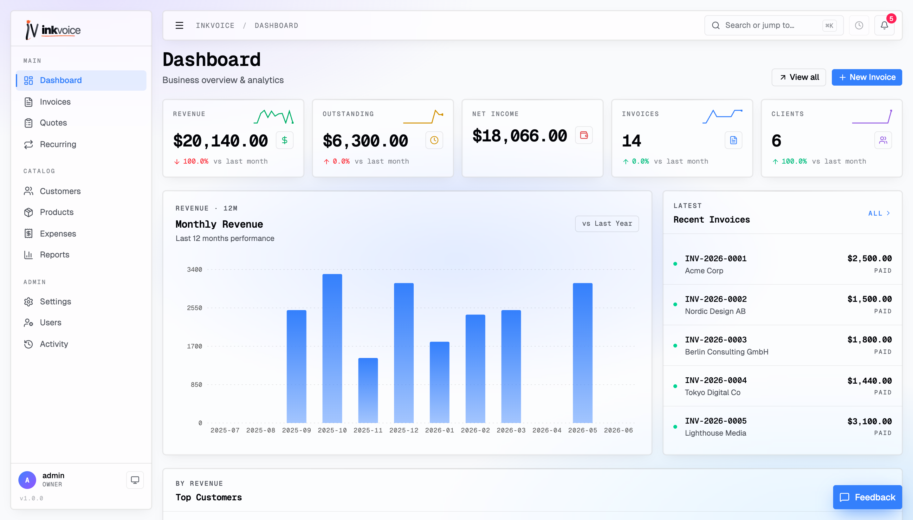

<div align="center">

<picture>
  <source media="(prefers-color-scheme: dark)" srcset="./docs/branding/inkvoice-lockup-dark.png">
  
</picture>

### Open-source invoicing for freelancers and small teams

Create invoices, get paid online, track expenses, and own your data, all from a single small container.

[](https://github.com/pigontech/inkvoice/actions/workflows/ci.yml)
[](./LICENSE)

**[Live Demo](https://demo.inkvoice.app) · [Documentation](https://docs.inkvoice.app) · [Inkvoice Cloud](https://cloud.inkvoice.app) · [Website](https://inkvoice.app)**



</div>

## Features

- Invoices, quotes, recurring invoices and credit notes with customizable PDF templates
- Online payments via Stripe and PayPal
- Expenses, multi-currency and reports with CSV export
- German and French e-invoicing (XRechnung, ZUGFeRD, Factur-X) and PEPPOL
- Multi-user with roles, SSO (OIDC), and five languages
- Single SQLite file, around 50 MB of RAM
- [iOS](https://apps.apple.com/app/id6821815185) and [Android](https://play.google.com/store/apps/details?id=com.pigontech.inkvoice) apps

Try the [live demo](https://demo.inkvoice.app) with `demo` / `demo`.

## Quick start

```bash
docker run -d --name inkvoice \
  -p 3000:3000 \
  -v invoice-data:/app/data \
  --memory 512m \
  -e JWT_SECRET="$(openssl rand -base64 48)" \
  -e ADMIN_PASS="change-me-please" \
  -e COOKIE_SECURE=false \
  ghcr.io/pigontech/inkvoice:latest
```

Open [http://localhost:3000](http://localhost:3000) and sign in as `admin`.

For Dokploy, Coolify, HTTPS and configuration, see the [docs](https://docs.inkvoice.app/guide/deployment). Prefer not to self-host? Use [Inkvoice Cloud](https://cloud.inkvoice.app).

## Development

```bash
bun install
bun run dev
```

See [CONTRIBUTING.md](./CONTRIBUTING.md) and the [architecture overview](./docs/ARCHITECTURE.md).

## License

Code is [MIT](./LICENSE). The Inkvoice name and logos are trademarks, see [TRADEMARK.md](./TRADEMARK.md).
